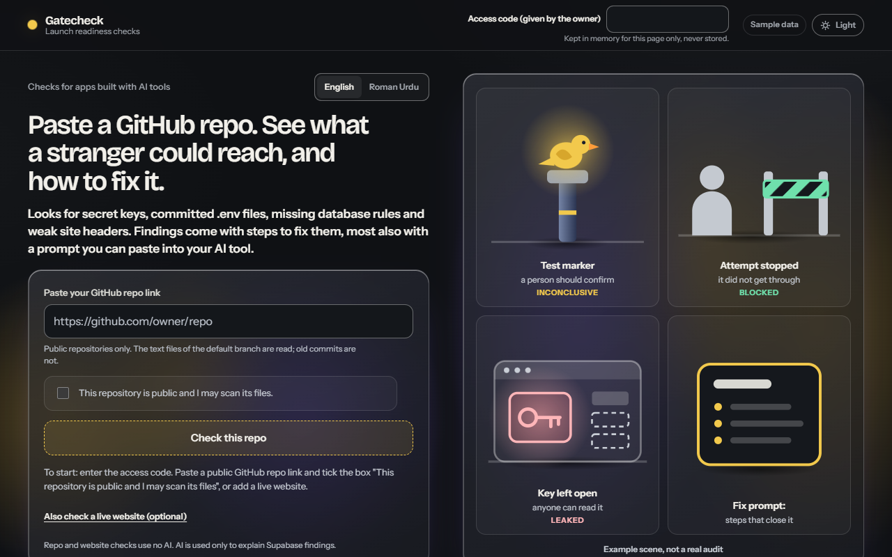
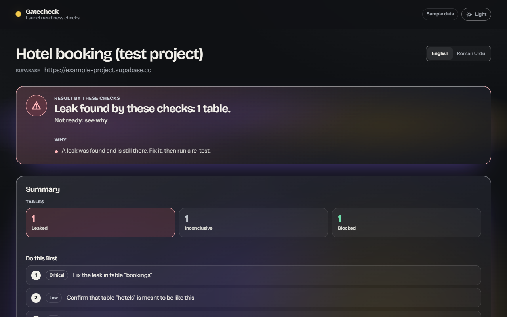
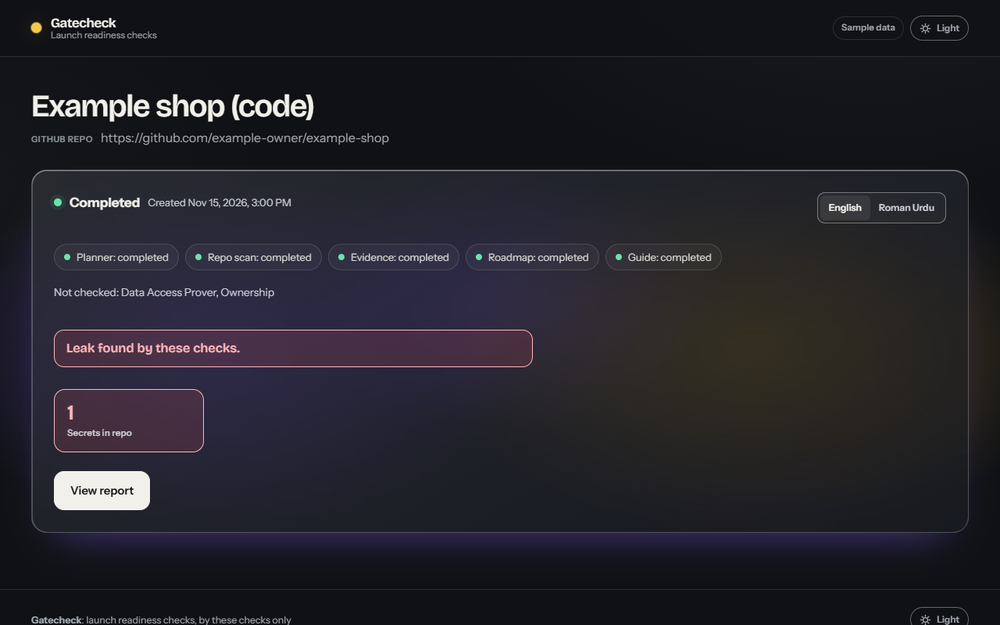
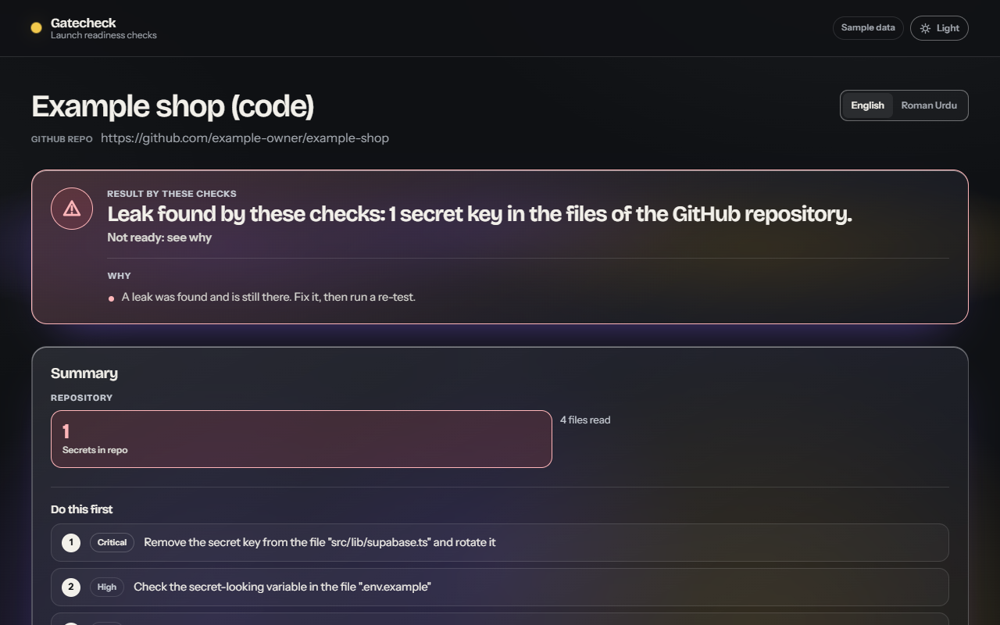
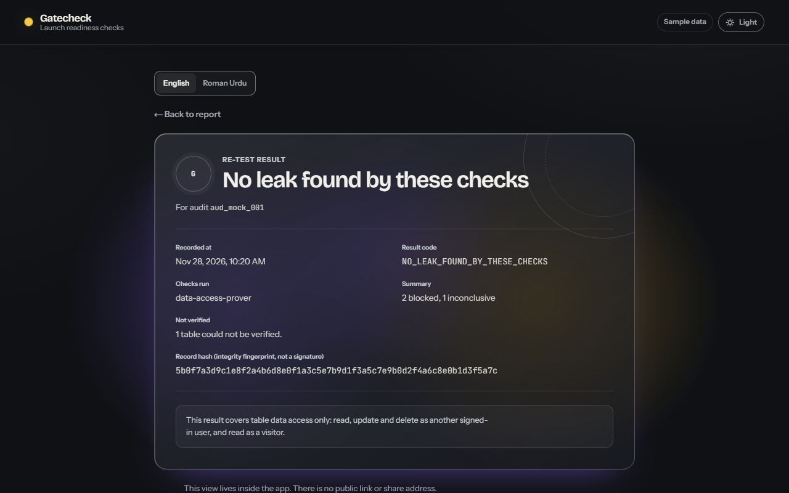
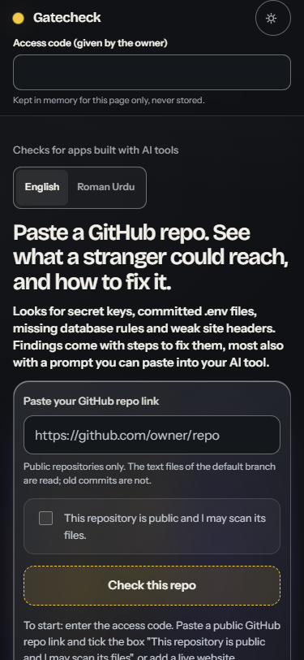
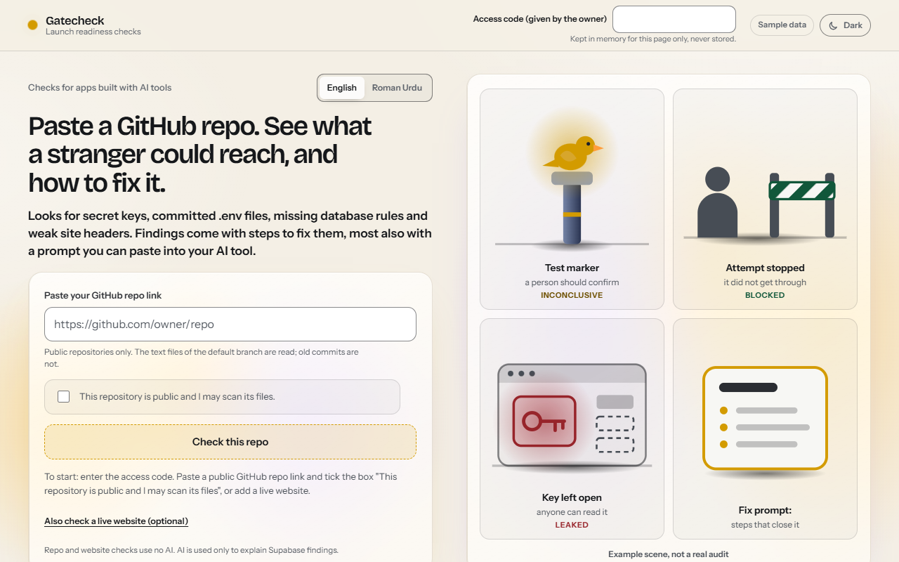

# Gatecheck

Gatecheck runs launch readiness checks on three things: a live website (weak or missing headers, and secret keys in its scripts), the table access of a Supabase project, and a public GitHub repo (secret keys, committed `.env` files and database migrations without row level security). It gives one gate result, by these checks, with the evidence. The rest of this page is mostly about the Supabase check, which works on a **test project** only. It creates two temporary users in that project, plants one canary row owned by user A, and tries to reach it as user B and as a visitor with no login. For each table it reports `LEAKED`, `BLOCKED` or `INCONCLUSIVE`, with the evidence and a reproducer. For a leak it suggests fix SQL that a human approves and applies, and a Re-test shows whether the fix worked. The result is "no leak found by these checks". It is not a statement that an app is secure.



## Live

- App (Vercel): https://vibe-code-auditor-five.vercel.app
- API (Railway): https://vibe-code-auditor-production.up.railway.app (`GET /health` answers `{"status":"ok"}`)

## How to try it

You need your own empty Supabase **test** project. Do not use a real or production project.

1. In Supabase, create a new, empty project for testing.
2. In its SQL editor, create a table with a `user_id` column and one text column, and leave row level security off:

   ```sql
   create table public.notes (
     id uuid primary key default gen_random_uuid(),
     user_id uuid not null,
     body text
   );
   alter table public.notes disable row level security;
   ```

3. Open the app and enter the access code (see below).
4. On the home page, open **Advanced: Supabase test project** at the bottom, enter your project's address, publishable key and secret key, tick the box that says it is a test project, and press **Run these checks**. The keys are only used for this audit; see "Security notes".
5. Expected result for `notes`: **LEAKED**. User B (or the visitor) was able to reach the canary row.
6. On the report, open the finding and read the suggested fix SQL. **Approve** it. Approving only records your decision; nothing changes in your database.
7. Apply the fix SQL yourself in the Supabase SQL editor.
8. Press **Re-test**. The same checks run again. If the table now answers `BLOCKED`, the finding shows as verified fixed.
9. When no table is `LEAKED`, at least one is `BLOCKED` and cleanup did not fail, **Open result view** on the report opens the **Re-test result** screen. It says "no leak found by these checks" and carries an integrity fingerprint, which is not a signature.



### Access code

The audit routes need an access code, so the public service cannot be used by anyone who finds the address. The code is not published here. To test with our access code, contact the team.

## What is checked, and what is not

For each table that the project's REST API lists:

- User B (a second signed-in test user) tries to **read**, **update** and **delete** a temporary canary row owned by user A. A blocked update can answer HTTP 200 and change nothing, so the Prover re-reads the row with the secret key and judges by that, not by the status code.
- A visitor with no login tries to **read** the canary row.
- The owner (user A) reads the row, and inserts one, as a control. If B and the visitor received nothing but the owner is blocked too, the result is `INCONCLUSIVE`, not `BLOCKED`, because "nobody got the row" proves nothing when the table does not work for its owner.

Verdicts:

- `LEAKED`: B or the visitor received the canary row, or B changed or deleted it.
- `BLOCKED`: B and the visitor received nothing, the row is unchanged, and the owner can still use the table.
- `INCONCLUSIVE`: for example a table with no owner column that is readable by everyone (maybe public on purpose), the canary could not be planted, or the owner is blocked too. The reason is stated.

Not covered: inserts by other users or visitors (a spoofed insert is not tested), database functions (RPC), Storage, Realtime, Edge Functions, Auth settings, other schemas, and column-level rules.

Limits: updates are tested only on tables that have a text column; tables whose names contain characters other than letters, digits or underscore are skipped; a table with more than 100 rows stops the audit.

The full rules are in [`docs/prover-spec.md`](docs/prover-spec.md).

## Architecture

```
Browser (Next.js, Vercel)  --HTTPS-->  API (NestJS, Railway)  --HTTPS-->  your Supabase TEST project
                                          |
                                          +--> pipeline runner: Prover agent, then Report agent
                                                                (Report agent calls Groq, off by default)

Claude Code  --stdio-->  MCP server (mcp/)  --HTTPS-->  the same API
```

- **Frontend** (`frontend/`): Next.js and React, deployed on Vercel. Dark theme by default with a light option, and an installable app (PWA) whose only offline feature is a fallback page.
- **Backend** (`backend/`): NestJS and TypeScript, deployed on Railway. Audits are kept in a table in the platform's own Supabase project (never the project being tested), so they survive a restart; the newest 50 are kept. The routes are in [`docs/api-contract.md`](docs/api-contract.md).
- **Data Access Prover**: the part that creates the temporary users, plants the canary rows, runs the attacks, and always cleans up. Data goes through `@supabase/supabase-js`. It can also be run alone with `npm run prove` in `backend/`.
- **Pipeline runner**: runs the agents one after another. If a critical agent (the Prover) fails, the run stops. If a non-critical agent fails, the audit still completes and the failed agent is shown in the `modules` list.
- **Report agent (Groq), off by default**: with `REPORT_AGENT=groq` it may rewrite only the English explanation text of a finding. The verdict, severity, evidence, fix SQL and Urdu text always stay as the Prover made them. Its text must pass checks (a closed word list, two sentences, no claims such as "secure" or "safe", no severity words); text that fails is replaced by the Prover's own template text. What is sent to Groq: table names and check results, never keys.
- **MCP server** (`mcp/`): lets Claude Code start an audit, read the report, ask for a Re-test and get the result record, through five tools. It has no tool to approve a fix; that stays a human decision. Keys are read from its own `.env` at start-up and never pass through the model. See [`mcp/README.md`](mcp/README.md).

## Security notes

- **Keys are used from memory only.** The keys of the test project are sent with the request that starts an audit (and again with a Re-test). They are never stored on the audit, never returned by the API, and never logged. In the browser the access code is kept in memory and not in `localStorage`.
- **Redaction.** Error text and agent messages are cleaned of the keys before they are stored or shown. The MCP server replaces its configured keys with `[REDACTED]` in every result and error.
- **TEST confirmation.** An audit starts only when the request says `confirmTestProject: true`. The API also refuses any project address that is not `https://<project-ref>.supabase.co`.
- **100-row stop.** If any table has more than 100 rows, the audit stops before it changes anything, because that does not look like a test project.
- **Cleanup.** The temporary users and canary rows are removed in a `finally` block, and the result says `cleanup: "ok"` or `"failed"`. Every call to Supabase has a 20 second timeout.
- **Access code.** Every `/api/v1/audits` route needs the `X-Access-Code` header. The server does not start without a code of at least 24 characters (unless `ALLOW_OPEN_API=yes`, for local testing only). Ten wrong tries from one client address within 15 minutes give `429 RATE_LIMITED`.
- **Service worker.** It stores only one offline page. It never stores an API answer, a script or a style, and never sees a request that carries the access code.
- Secrets live only in `backend/.env` (local) and Railway Variables. `.env` files are git-ignored.

## Limitations

- Table data access only (see "What is checked, and what is not"). A result of "no leak found by these checks" says nothing about the rest of the app.
- Test projects only, with at most 100 rows per table.
- One audit runs at a time; a second one gets `409 AUDIT_IN_PROGRESS`.
- Only the newest 50 audits are kept. A run that a restart cuts off is closed as `INTERRUPTED`. A Re-test needs the keys again.
- Fix SQL is a suggestion. The tool never applies it.
- Badges and fix progress in the browser are kept in `localStorage`. They are a convenience, not proof.
- Not yet verified in a real browser by the author: the install prompt, offline behaviour on a device, and the look of both themes on every device.

## Screenshots

All screenshots use sample data: no real audit, project or key is in them.


*Home page, dark theme (1280×800).*



*Run page of a finished audit of a repository.*


*Result of a Supabase test project: the gate, the counts and the first steps.*



*Result of a GitHub repo: the gate, the counts and the first steps.*



*The Re-test result screen, after a fix was checked again.*



*Home page on a phone (375×812).*



*Home page, light theme.*

## Repository

- `backend/`: API and Prover. `backend/README.md` has the setup, the routes and the environment variables.
- `frontend/`: the web app.
- `mcp/`: the MCP server.
- `docs/`: `api-contract.md`, `prover-spec.md`, `frontend-brief.md`, `roadmap.md`.
